# Terminal Management System - Technical Documentation

## Scope

This document describes the current Terminal Management System application: its architecture, Docker runtime, database model, endpoints, Redis caching behavior, cron cleanup behavior, logging, testing, and main operational flows.

It is intentionally a technical documentation file and not a README.

## System Overview

The application is a Flask-based API for managing POS terminals. It uses MySQL as the source of truth, Redis as a cache layer, Pandas for statistics endpoints, and Docker Compose to run the required services.

The system currently contains these main runtime services:

- `tms-api`: Flask API container.
- `mysql`: MySQL database container.
- `redis`: Redis cache container.
- `decommission-cleanup`: separate cron container for deleting expired decommissioned terminals.
- `tests`: optional pytest service under the `tests` Compose profile.

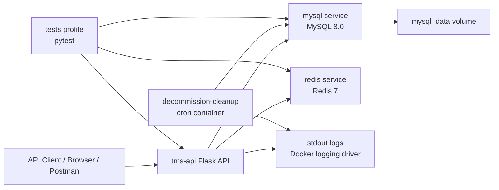

## Source Layout

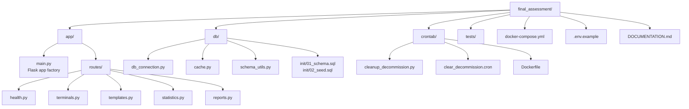

## Application Startup

The Flask app is created in `app/main.py`.

Important startup behavior:

- Logging is configured to write to `stdout`.
- JSON key sorting is disabled with `app.json.sort_keys = False`.
- Unicode JSON output is enabled with `app.json.ensure_ascii = False`.
- Route files are registered as Flask Blueprints.

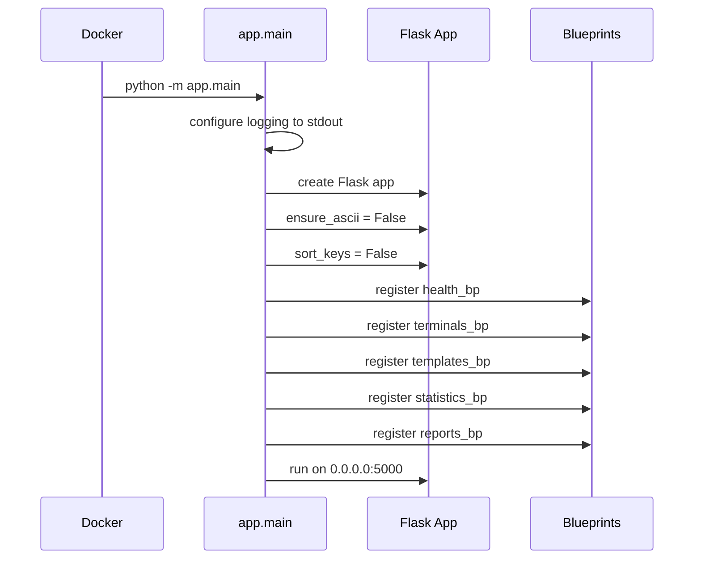

## Docker Runtime

The project is started with Docker Compose. The API waits for MySQL and Redis healthchecks before starting.

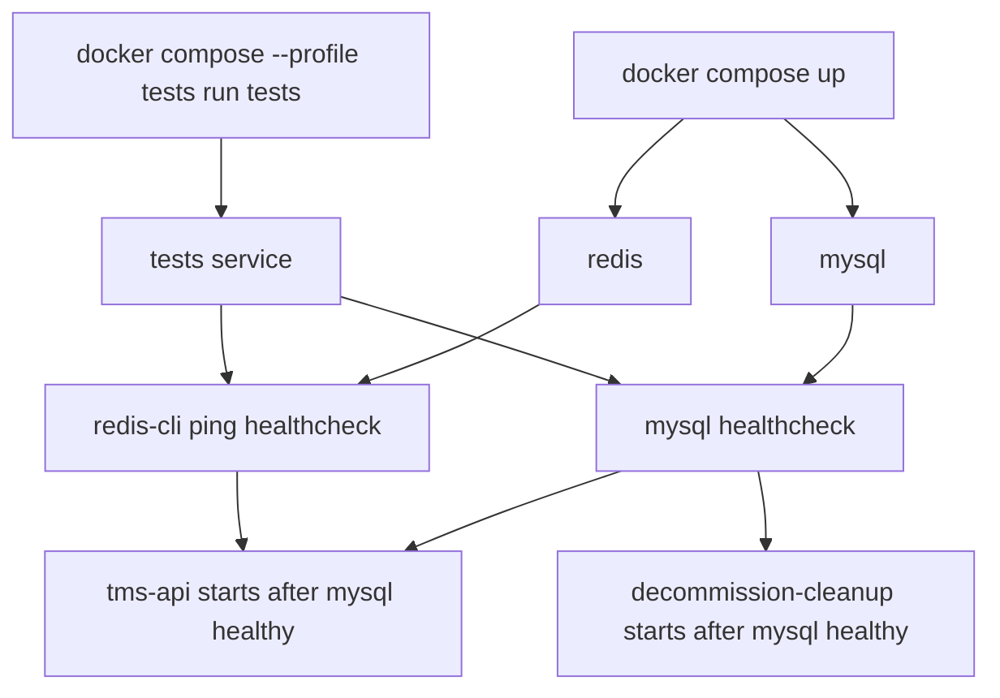

### Service Responsibilities

| Service | Responsibility | Persistence | Health |
|---|---|---|---|
| `mysql` | Stores merchants, templates, terminals, decommission queue | `mysql_data:/var/lib/mysql` | `mysqladmin ping` |
| `redis` | Cache layer for GET endpoints | No active volume in current compose | `redis-cli ping` |
| `tms-api` | Flask API | Stateless | Depends on MySQL and Redis health |
| `decommission-cleanup` | Runs cron cleanup every night | Stateless | Depends on MySQL health |
| `tests` | Runs pytest when profile is enabled | Stateless | Depends on MySQL and Redis health |

### Docker Volumes

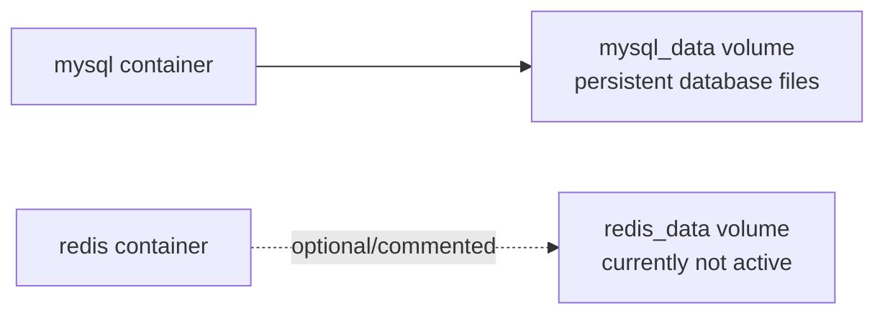

The current Compose file persists MySQL data through `mysql_data`.

Redis persistence is intentionally not active. This is acceptable for a cache because cache data can be rebuilt from MySQL after restart.

### Docker Log Rotation

The Compose file defines a shared logging configuration:

```yaml
x-logging: &default-logging
  driver: "json-file"
  options:
    max-size: "10m"
    max-file: "10"
```

Every service uses:

```yaml
logging: *default-logging
```

This means Docker rotates container logs when each log file reaches `10MB`, keeping up to `10` files per container. The application still writes logs to `stdout`; Docker handles the rotation.

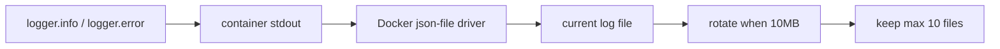

## Database Model

The seed schema creates three core tables:

- `merchants`
- `templates`
- `terminals`

The application adds/ensures two additional structures at runtime:

- `terminals.updated_on`
- `decommission_queue`

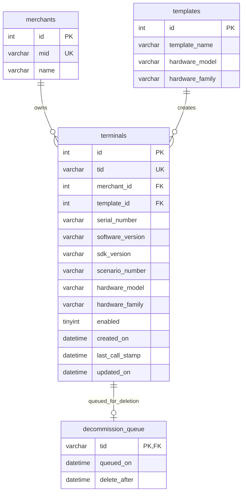

### Runtime Schema Safety

`db/schema_utils.py` provides idempotent schema helpers:

- `ensure_updated_on_column(conn)`: checks `INFORMATION_SCHEMA.COLUMNS` before running `ALTER TABLE`.
- `ensure_decommission_queue_table(conn)`: uses `CREATE TABLE IF NOT EXISTS`.

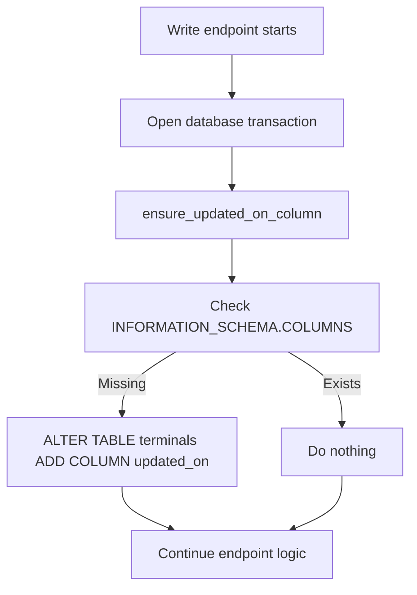

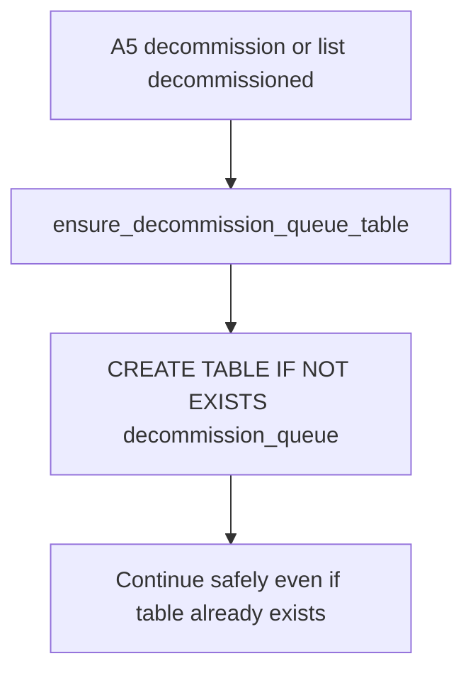

## API Endpoint Map

```mermaid
flowchart TD
    API["tms-api"]

    API --> Health["GET /health"]

    API --> Terminals["Terminals"]
    Terminals --> A1["GET /terminals"]
    Terminals --> A1Filter["GET /terminals?enabled=true|false"]
    Terminals --> A2["GET /terminals/&lt;tid&gt;"]
    Terminals --> A3["GET /terminals/flagged"]
    Terminals --> A4Flag["POST /terminals/&lt;tid&gt;/flag"]
    Terminals --> A4Unflag["POST /terminals/&lt;tid&gt;/unflag"]
    Terminals --> A5Post["POST /terminals/&lt;tid&gt;/decommission"]
    Terminals --> A5Get["GET /terminals/decommissioned"]
    Terminals --> B3["POST /terminals/from-template"]

    API --> Templates["Templates"]
    Templates --> B1["GET /templates"]
    Templates --> B2["GET /templates/&lt;id&gt;"]

    API --> Statistics["Statistics"]
    Statistics --> D1["GET /statistics/by-hardware"]
    Statistics --> D2["GET /statistics/by-state"]
    Statistics --> D3["GET /statistics/by-hardware-family"]
    Statistics --> D4["GET /statistics/idle-distribution"]

    API --> Reports["Reports"]
    Reports --> CSV["GET /reports/terminals_basic.csv"]
```

## Endpoint Reference

### Health

| Method | Path | Purpose |
|---|---|---|
| `GET` | `/health` | Checks database and Redis availability |

Success response:

```json
{
  "status": "ok",
  "database": "ok",
  "cache": "ok"
}
```

Degraded response returns `503` and marks the failing component.

### Terminals

| Method | Path | Cache | Purpose |
|---|---|---|---|
| `GET` | `/terminals` | TTL 30s | List terminals |
| `GET` | `/terminals?enabled=true` | TTL 30s | List enabled terminals |
| `GET` | `/terminals?enabled=false` | TTL 30s | List disabled terminals |
| `GET` | `/terminals/<tid>` | TTL 30s | Return one terminal |
| `GET` | `/terminals/flagged` | TTL 30s | Return terminals with active `scenario_number` |
| `POST` | `/terminals/<tid>/flag` | Clears all cache | Flag terminal for upgrade |
| `POST` | `/terminals/<tid>/unflag` | Clears all cache | Reset `scenario_number` to `'0'` |
| `POST` | `/terminals/<tid>/decommission` | Clears all cache | Disable terminal and queue deletion |
| `GET` | `/terminals/decommissioned` | TTL 30s | List queued decommissioned terminals |
| `POST` | `/terminals/from-template` | Clears all cache | Create terminal from template |

### Templates

| Method | Path | Purpose |
|---|---|---|
| `GET` | `/templates` | List templates |
| `GET` | `/templates/<id>` | Return one template or `404` |

### Statistics

All statistics endpoints use Pandas and Redis cache with TTL 60 seconds.

| Method | Path | Pandas operation |
|---|---|---|
| `GET` | `/statistics/by-hardware` | `groupby("hardware_model").size()` |
| `GET` | `/statistics/by-state` | `value_counts()` over `enabled` |
| `GET` | `/statistics/by-hardware-family` | `groupby("hardware_family").size()` |
| `GET` | `/statistics/idle-distribution` | `pd.cut()` buckets and `groupby("range").size()` |

### Reports

| Method | Path | Purpose |
|---|---|---|
| `GET` | `/reports/terminals_basic.csv` | Dynamically generates and downloads `terminals_basic.csv` |

The CSV is generated in memory using `io.StringIO()` and returned as an HTTP response. It is not saved as a permanent project file.

CSV columns:

```csv
tid,mid,hardware_model,software_version,enabled,last_call
```

## Caching Design

The application uses a cache-aside pattern.

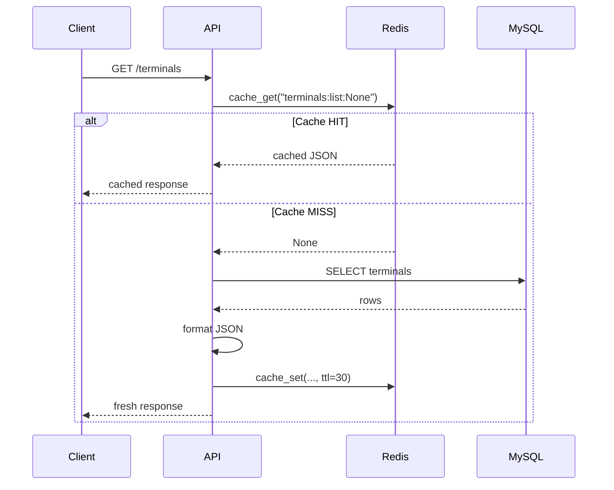

### Cache Keys

| Endpoint | Cache key |
|---|---|
| `GET /terminals` | `terminals:list:None` |
| `GET /terminals?enabled=true` | `terminals:list:true` |
| `GET /terminals?enabled=false` | `terminals:list:false` |
| `GET /terminals/<tid>` | `terminals:detail:<tid>` |
| `GET /terminals/flagged` | `terminals:flagged` |
| `GET /terminals/decommissioned` | `terminals:decommissioned:list` |
| `GET /statistics/by-hardware` | `statistics:by-hardware` |
| `GET /statistics/by-state` | `statistics:by-state` |
| `GET /statistics/by-hardware-family` | `statistics:by-hardware-family` |
| `GET /statistics/idle-distribution` | `statistics:idle-distribution` |

### Cache TTLs

| Group | TTL |
|---|---|
| Terminals read endpoints | 30 seconds |
| Statistics endpoints | 60 seconds |

### Cache Invalidation

Every write endpoint clears the full Redis database using `cache_clear_all()`.

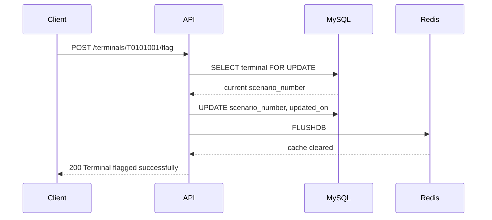

### Redis Failure Behavior

Redis failures are handled inside `db/cache.py`.

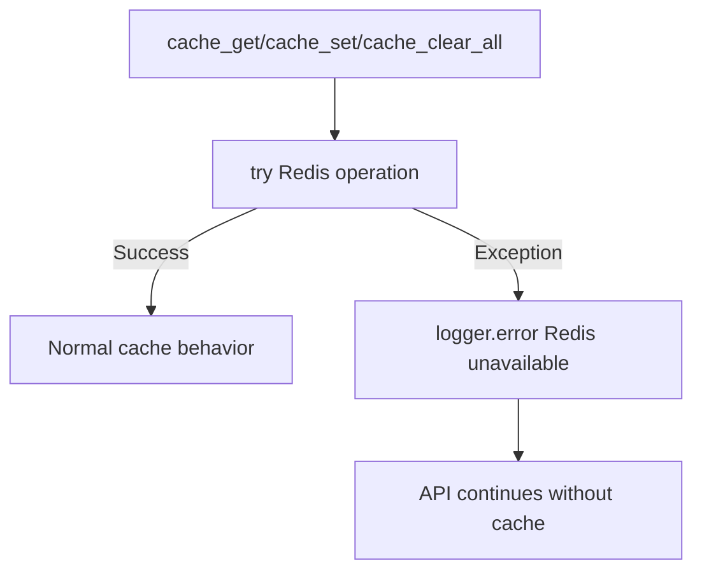

This means the API should not crash if Redis is unavailable. It simply behaves as if there is no cache.

## Feature A - Terminal Flows

### A1: List Terminals

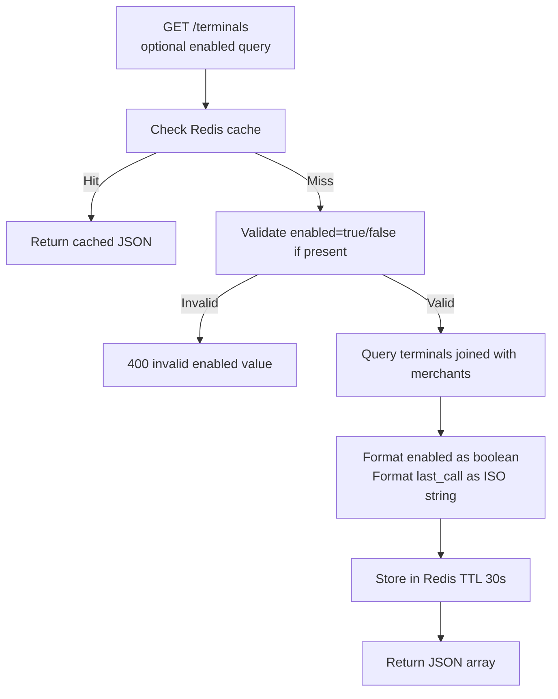

### A4: Flag Terminal

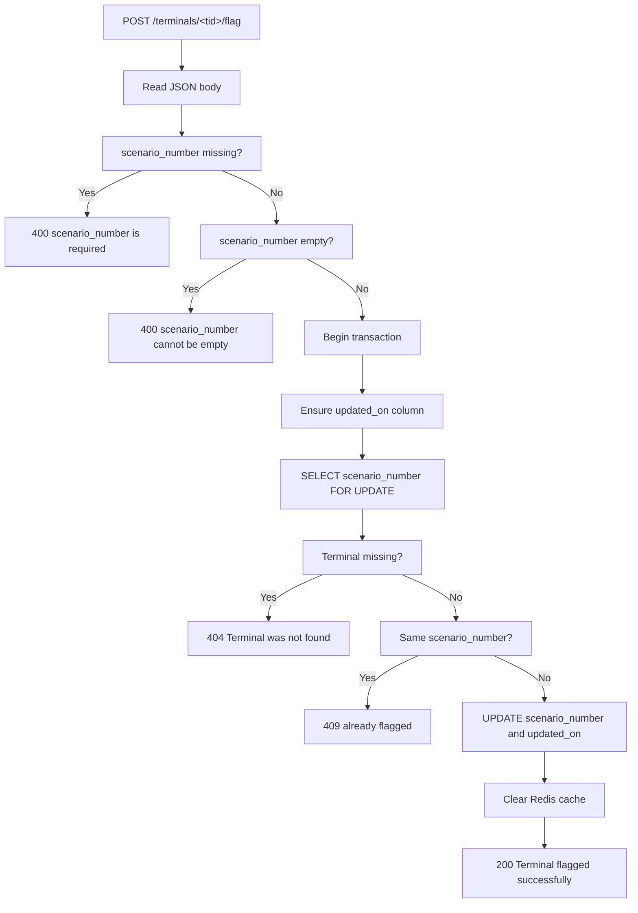

### A4: Unflag Terminal

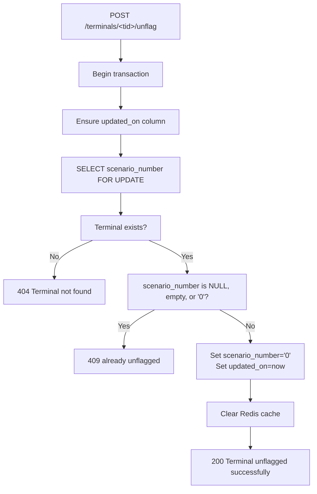

### A5: Decommission Terminal

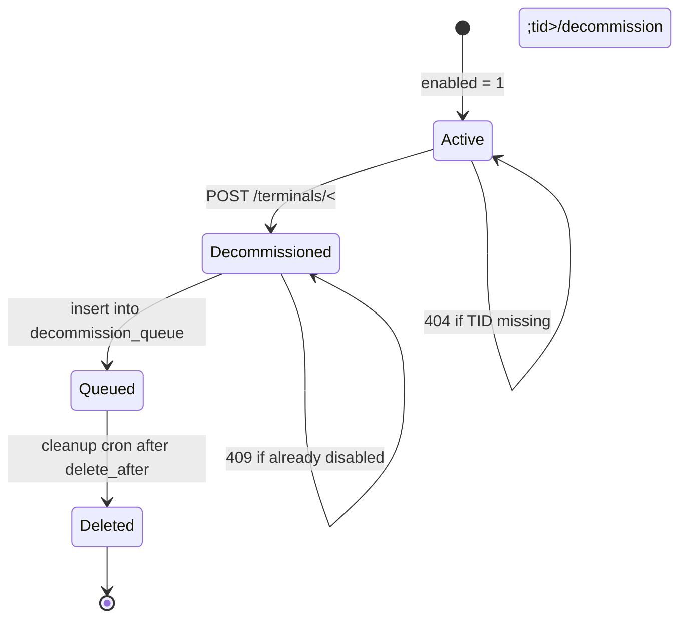

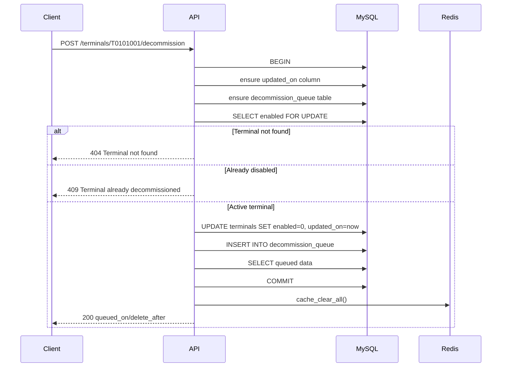

## Feature B - Templates and Create From Template

### Template Endpoints

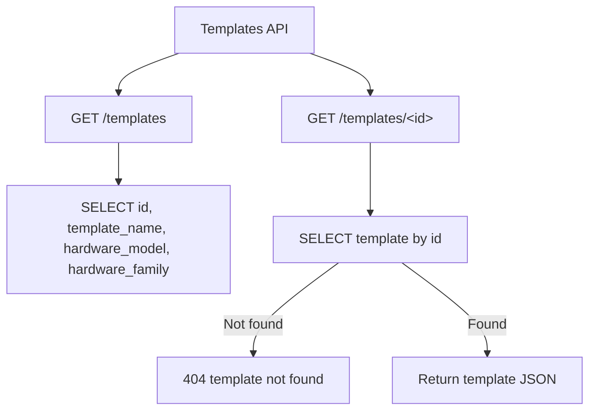

### Create Terminal From Template

The create-from-template endpoint runs inside a single transaction.

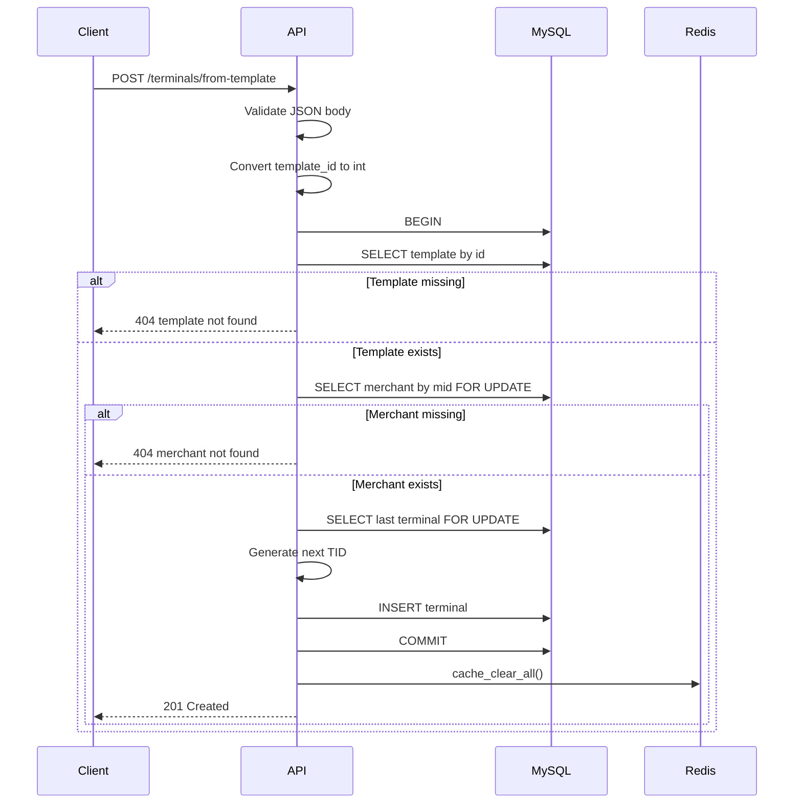

TID generation:

```mermaid
flowchart TD
    MID["mid = MID000101"] --> Prefix["prefix = T + last 4 chars<br/>T0101"]
    Last["last tid for merchant<br/>T0101006"] --> Suffix["suffix = 006"]
    Suffix --> Increment["increment to 007"]
    Prefix --> NewTID["new tid = T0101007"]
    Increment --> NewTID
```

## Feature D - Statistics With Pandas

All statistics endpoints follow this pattern:

```mermaid
flowchart TD
    Request["GET /statistics/..."] --> Cache["Check Redis cache"]
    Cache -->|Hit| Cached["Return cached JSON"]
    Cache -->|Miss| Select["SELECT raw column(s) from MySQL"]
    Select --> DataFrame["Create Pandas DataFrame"]
    DataFrame --> Aggregate["Calculate aggregation with Pandas"]
    Aggregate --> Response["Build JSON with generated_at"]
    Response --> CacheSet["cache_set TTL 60s"]
    CacheSet --> Return["Return JSON"]
```

### D1: By Hardware

```mermaid
flowchart LR
    SQL["SELECT hardware_model FROM terminals"] --> DF["DataFrame"]
    DF --> Group["groupby('hardware_model').size()"]
    Group --> JSON["{ generated_at, data: [{hardware_model, count}] }"]
```

### D2: By State

```mermaid
flowchart LR
    SQL["SELECT enabled FROM terminals"] --> DF["DataFrame"]
    DF --> Counts["value_counts()"]
    Counts --> Active["active = count of 1"]
    Counts --> Inactive["inactive = count of 0"]
    Active --> JSON["{ generated_at, active, inactive, total }"]
    Inactive --> JSON
```

### D3: By Hardware Family

```mermaid
flowchart LR
    SQL["SELECT hardware_family FROM terminals"] --> DF["DataFrame"]
    DF --> Group["groupby('hardware_family').size()"]
    Group --> JSON["{ generated_at, data: [{hardware_family, count}] }"]
```

### D4: Idle Distribution

```mermaid
flowchart TD
    SQL["SELECT last_call_stamp FROM terminals"] --> DF["DataFrame"]
    DF --> Days["days_since_last_call = now - last_call_stamp"]
    Days --> Buckets["pd.cut() into buckets"]
    Buckets --> Group["groupby('range').size()"]
    Group --> JSON["{ generated_at, data: [{range, count}] }"]
```

Idle buckets:

| Bucket | Meaning |
|---|---|
| `Σήμερα` | Last call today |
| `1-7 μέρες` | Last call 1 to 7 days ago |
| `8-30 μέρες` | Last call 8 to 30 days ago |
| `31-90 μέρες` | Last call 31 to 90 days ago |
| `90+ μέρες` | Last call more than 90 days ago |

## CSV Report

The CSV report endpoint creates a CSV response dynamically.

```mermaid
sequenceDiagram
    participant Client
    participant API
    participant MySQL

    Client->>API: GET /reports/terminals_basic.csv
    API->>MySQL: SELECT terminal + merchant fields
    MySQL-->>API: rows
    API->>API: Build CSV in memory with StringIO
    API-->>Client: text/csv attachment terminals_basic.csv
```

The endpoint does not write a permanent `.csv` file to the repository or container filesystem. It generates the CSV at request time and returns it with:

```http
Content-Disposition: attachment; filename=terminals_basic.csv
Content-Type: text/csv; charset=utf-8
```

## Cron Decommission Cleanup

The bonus cleanup runs in a separate container.

Cron schedule:

```cron
0 2 * * * cd /app && /usr/local/bin/python /app/crontab/cleanup_decommission.py >> /proc/1/fd/1 2>> /proc/1/fd/2
```

This runs every day at `02:00`.

```mermaid
sequenceDiagram
    participant Cron as cron daemon
    participant Script as cleanup_decommission.py
    participant MySQL
    participant DockerLogs as Docker stdout/stderr logs

    Cron->>Script: run daily at 02:00
    Script->>MySQL: ensure decommission_queue table
    Script->>MySQL: SELECT tid WHERE delete_after < now
    alt No expired rows
        Script->>DockerLogs: log "No expired..."
    else Expired rows found
        loop each expired terminal
            Script->>MySQL: DELETE FROM decommission_queue
            Script->>MySQL: DELETE FROM terminals
            Script->>DockerLogs: log deleted TID
        end
        Script->>DockerLogs: log cleanup summary
    end
```

The delete order matters:

```mermaid
flowchart LR
    Queue["decommission_queue<br/>FK references terminals.tid"] --> Terminal["terminals"]
    DeleteQueue["1. Delete queue row first"] --> DeleteTerminal["2. Delete terminal row second"]
```

Because `decommission_queue.tid` references `terminals.tid`, the queue row must be deleted before deleting the terminal row.

## Logging

Application logging is configured in `app/main.py`.

Format:

```text
%(asctime)s [%(levelname)-8s] %(name)s - %(message)s
```

Example:

```text
2026-07-14 10:02:59,305 [INFO    ] app.routes.statistics - Fetched 68 rows from the database for hardware model statistics.
```

```mermaid
flowchart TD
    Code["logger.info / logger.error"] --> PythonLogging["Python logging"]
    PythonLogging --> Stdout["stdout"]
    Stdout --> DockerLogs["docker compose logs"]
    DockerLogs --> Rotation["Docker json-file rotation<br/>10MB x 10 files"]
```

Logs are not written to application-managed files.

## Error Handling

The application uses `try/except` around database and Redis operations.

Common error response pattern:

```json
{
  "error": "database error"
}
```

Expected user-facing errors include:

| Case | Status |
|---|---|
| Terminal not found | `404` |
| Template not found | `404` |
| Merchant not found | `404` |
| Missing `scenario_number` | `400` |
| Empty `scenario_number` | `400` |
| Already flagged with same scenario number | `409` |
| Already unflagged | `409` |
| Already decommissioned | `409` |
| Wrong HTTP method | `405` |

```mermaid
flowchart TD
    Request["Request"] --> Validate["Validate input"]
    Validate -->|Bad input| ClientError["400 / 404 / 409"]
    Validate -->|Valid| DB["Database operation"]
    DB -->|Success| Response["2xx response"]
    DB -->|Exception| Log["logger.error"]
    Log --> ServerError["500 database error"]
```

## Security and Query Safety

User inputs are passed to SQL using bind parameters instead of f-string SQL interpolation.

Example pattern:

```python
conn.execute(
    text("SELECT * FROM terminals WHERE tid = :tid"),
    {"tid": tid}
)
```

Environment variables are loaded from `.env` / `.env.example` and are not hardcoded in the source code.

## Health Checks

There are two kinds of health checks:

- Application HTTP health endpoint: `GET /health`.
- Docker Compose service healthchecks for MySQL and Redis.

```mermaid
flowchart TD
    Client["GET /health"] --> API["Flask health endpoint"]
    API --> DBCheck["SELECT 1 against MySQL"]
    API --> RedisCheck["redis_client.ping()"]
    DBCheck --> Status["Build component status"]
    RedisCheck --> Status
    Status -->|All ok| OK["200 status=ok"]
    Status -->|Any error| Degraded["503 status=degraded"]
```

## Testing

The project has pytest coverage for route registration, cache behavior, cron cleanup, endpoint behavior, route validation, schema utilities, and statistics behavior.

```mermaid
flowchart TD
    Tests["pytest suite"] --> AppReg["test_app_registration.py"]
    Tests --> CacheTests["test_cache.py"]
    Tests --> CronTests["test_cron_cleanup.py"]
    Tests --> EndpointTests["test_endpoint_behaviour.py"]
    Tests --> RouteValidation["test_route_validation.py"]
    Tests --> SchemaTests["test_schema_utils.py"]
    Tests --> StatisticsTests["test_statistics_behaviour.py"]
```

The Docker tests service is enabled only when the `tests` profile is used.

```mermaid
sequenceDiagram
    participant User
    participant Compose
    participant MySQL
    participant Redis
    participant Tests

    User->>Compose: docker compose --profile tests run --rm tests
    Compose->>MySQL: ensure healthy
    Compose->>Redis: ensure healthy
    Compose->>Tests: run pytest
    Tests-->>User: pass/fail result
```

Current verified result after the latest statistics changes:

```text
40 passed
```

## Main Data Lifecycles

### Normal Terminal Read

```mermaid
flowchart LR
    Client --> API
    API --> RedisCheck["Check Redis"]
    RedisCheck -->|Hit| Client
    RedisCheck -->|Miss| MySQL
    MySQL --> API
    API --> RedisStore["Store cache"]
    RedisStore --> Client
```

### Terminal Upgrade Flag Lifecycle

```mermaid
stateDiagram-v2
    [*] --> Unflagged: scenario_number NULL/empty/'0'
    Unflagged --> Flagged: POST /flag
    Flagged --> Flagged: POST /flag with different scenario_number
    Flagged --> Unflagged: POST /unflag
```

### Decommission Lifecycle

```mermaid
flowchart LR
    Day0["Day 0<br/>Terminal is active"] --> Decom["POST /terminals/{tid}/decommission"]
    Decom --> Disabled["enabled set to 0"]
    Disabled --> Queue["row inserted into decommission_queue"]
    Queue --> Waiting["Day 1-2<br/>GET /terminals/decommissioned shows days_remaining"]
    Waiting --> Expired["Day 3+<br/>delete_after is expired"]
    Expired --> Cron["cleanup cron runs"]
    Cron --> DeleteQueue["delete queue row"]
    DeleteQueue --> DeleteTerminal["delete terminal row"]
```

## Operational Notes

### Logs

Useful commands:

```bash
docker compose logs -f tms-api
docker compose logs -f decommission-cleanup
docker compose logs --tail=100 tms-api
```

### Cache Verification

Expected cache check:

```mermaid
sequenceDiagram
    participant User
    participant API
    participant Redis

    User->>API: GET /terminals
    API->>Redis: MISS
    User->>API: GET /terminals
    API->>Redis: HIT
    User->>API: POST /terminals/{tid}/flag
    API->>Redis: FLUSHDB
    User->>API: GET /terminals
    API->>Redis: MISS again
```

### CSV Download

The report can be downloaded from:

```text
http://localhost:5000/reports/terminals_basic.csv
```

### Cron Cleanup Logs

Cron output is redirected to Docker stdout/stderr:

```text
/proc/1/fd/1
/proc/1/fd/2
```

Therefore cleanup logs are visible with:

```bash
docker compose logs -f decommission-cleanup
```

## Design Decisions

### Why Redis Has No Active Volume

Redis is used as a cache layer, not as the source of truth. If Redis restarts and loses cache data, the API can safely read from MySQL and repopulate Redis.

```mermaid
flowchart LR
    RedisLost["Redis cache lost"] --> API["API receives GET"]
    API --> Miss["Cache MISS"]
    Miss --> MySQL["Read from MySQL"]
    MySQL --> Repopulate["Repopulate Redis"]
    Repopulate --> Response["Return response"]
```

### Why CSV Is Not Saved As A File

The assignment asks for an endpoint that produces `terminals_basic.csv`. The endpoint generates the CSV dynamically and returns it as a downloadable response. This avoids storing generated report files inside containers.

### Why Full Cache Clear Is Used On Writes

The application clears the full Redis DB after writes because multiple cached endpoints can be affected by a single change.

Example:

- Flagging a terminal affects `/terminals/<tid>`.
- It may affect `/terminals/flagged`.
- It may affect general terminal lists.
- It may affect statistics if enabled/state/hardware-related data changes through other write endpoints.

Full invalidation is simpler and safer for this project.

## Current Implementation Summary

```mermaid
flowchart TD
    TMS["TMS"]
    TMS --> Flask["Flask API"]
    Flask --> Blueprints["Blueprints"]
    Flask --> JSON["JSON responses"]
    Flask --> MethodHandler["405 handler"]

    TMS --> MySQL["MySQL"]
    MySQL --> Seed["Seed schema"]
    MySQL --> Volume["Persistent volume"]
    MySQL --> SchemaHelpers["Runtime schema helpers"]

    TMS --> Redis["Redis"]
    Redis --> CacheAside["Cache-aside"]
    Redis --> HitMiss["Hit/Miss logs"]
    Redis --> Fallback["Safe fallback"]

    TMS --> Pandas["Pandas"]
    Pandas --> HardwareStats["Hardware stats"]
    Pandas --> StateStats["State stats"]
    Pandas --> FamilyStats["Family stats"]
    Pandas --> IdleBuckets["Idle buckets"]

    TMS --> Docker["Docker"]
    Docker --> Services["Compose services"]
    Docker --> Healthchecks["Healthchecks"]
    Docker --> LogRotation["Log rotation"]

    TMS --> Cron["Cron"]
    Cron --> SeparateContainer["Separate container"]
    Cron --> DailyCleanup["Daily cleanup"]
    Cron --> StdoutLogs["Docker stdout logs"]

    TMS --> Tests["Tests"]
    Tests --> Pytest["Pytest"]
    Tests --> DockerProfile["Docker profile"]
```
